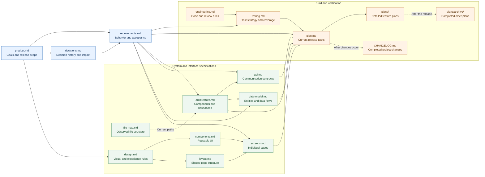

# Software Project Documentation Templates

This repository contains Markdown templates for planning, building, reviewing, and maintaining a software product with developers or coding agents. The templates are project-neutral: they do not prescribe a programming language, framework, database, API style, or visual design. A project owner or developer fills in those decisions for each system.

The documents serve different purposes. Each decision should have one authoritative home; other files link to it by document path or stable ID. These files guide implementation, but they do not execute tasks, run tests, or update themselves automatically.

## Start Here

For the conversation-driven path, make the skills available to your coding agent, open the **target software project**, and ask it to use `project-discovery`. Describe your idea in ordinary language. The agent asks follow-up questions and writes the documentation for you; you can correct decisions in conversation without editing Markdown.

`project-discovery` writes into the folder open in your coding agent. When you run it from this template repository instead, it creates a named child folder here, such as `./booking-demo/`, and writes that project's files there. Relative project names are resolved from the open folder; the user's home directory is never the default. An absolute path you explicitly provide takes precedence. The agent states the resolved path before writing.

The templates also work without the skills. If you prefer to fill them manually:

1. Copy the relevant templates into the project repository, keeping their relative links or updating the links after moving them.
2. Fill in [product.md](docs/product.md) to define users, the problem, goals, release scope, and constraints.
3. Turn the release scope into testable, numbered requirements in [requirements.md](docs/requirements.md). Record unresolved behavior under Open Questions rather than letting an implementer guess.
4. Define the system's component boundaries and technology choices in [architecture.md](docs/architecture.md). Fill in the API, data, and UI documents that apply to the project.
5. Fill in [engineering.md](docs/engineering.md) and [testing.md](docs/testing.md) with the project's actual tools, commands, and quality rules.
6. Create the current release's tasks in [plan.md](docs/plan.md). Add a detailed feature plan only when a task needs more execution detail.
7. Before implementation, replace bracketed prompts, remove unused example rows and sections, and check that links and IDs agree across documents.
8. Record each completed project change in [CHANGELOG.md](CHANGELOG.md), with the newest entry first and `---` between entries.

You do not need to complete every document before exploring an idea. Before a feature is implemented, its product decisions, required behavior, affected contracts, and completion checks should be clear enough to build and review it.

## Conversation-Driven Workflows

These skills let a project owner make decisions in conversation while the agent writes and maintains the Markdown:

| Skill | Use it for |
| --- | --- |
| [project-discovery](skills/project-discovery/SKILL.md) | Interview the owner and build the project-specific product, requirements, technical, UI, engineering, testing, and plan documents. It uses the bundled templates when a document is missing. |
| [feature-change](skills/feature-change/SKILL.md) | Add a feature, revise agreed behavior, or document a bug fix while tracking affected existing requirements and plans. |
| [docs-audit](skills/docs-audit/SKILL.md) | Review links, IDs, coverage, contradictions, and completion evidence across the documentation. |
| [understand-project](skills/understand-project/SKILL.md) | Inspect an existing project in manageable parts and write an evidence-linked report and source-fingerprint register with coverage status. |
| [update-project-docs](skills/update-project-docs/SKILL.md) | Check evidence freshness, draft supported updates to an existing project's documents, review the proposed diff with the owner, then apply the approved files. |
| [sync-project-docs](skills/sync-project-docs/SKILL.md) | Run project understanding and evidence-backed documentation drafting in one request, then present one proposal for review. |

The owner supplies decisions in conversation; the agent updates the files. The `skills/` directory contains the source packages. This repository also exposes them through `.agents/skills/` for agents that support that project-level convention. If your agent does not discover them automatically, point it to the relevant `SKILL.md` file.

Before granting an agent access to a project, read the [security policy](SECURITY.md) for guidance on permissions, untrusted content, and handling secrets.

### Releases

GitHub Actions runs Release Please on pushes to `main` and can also be started manually from the Actions tab. It reads Conventional Commit messages such as `feat: add a skill` and `fix: correct an audit check`, then opens a release pull request. Review and merge that pull request when you want to publish a version; Release Please then creates the version tag and GitHub Release. The release workflow leaves this repository's manually maintained `CHANGELOG.md` alone.

For the workflow to open pull requests, enable **Allow GitHub Actions to create and approve pull requests** under **Settings → Actions → General** if it is disabled. The workflow uses GitHub's built-in `GITHUB_TOKEN`; it does not require a personal access token. Keep adding a brief `CHANGELOG.md` entry for each persisted project change as described in [AGENTS.md](AGENTS.md).

The skills maintain [CHANGELOG.md](CHANGELOG.md) as a short history of persisted changes. One entry can cover several files changed for the same purpose; it should say what actually happened and include useful IDs. [decisions.md](docs/decisions.md) holds the reason and impact behind consequential product decisions. Runtime events belong in the project's logging system, not in this Markdown history.

For a consequential change, `feature-change` first shows the current rule, requested rule, affected IDs and files, and regression checks. It then updates the owning documents and records the confirmed choice in [decisions.md](docs/decisions.md). A clear request to make the change is enough to proceed; the impact preview is not an extra approval gate.

Run the mechanical documentation check from this repository:

```bash
python3 skills/docs-audit/scripts/check_docs.py /path/to/your-project
```

It reports broken local links, duplicate ID definitions, incomplete decision entries, undefined decision and task references, missing changelog separators, and requirements without a plan reference. It cannot establish whether two rules mean the same thing, whether a requirement is well designed, or whether a claimed test actually ran; use `docs-audit` for that review.

### Add the skills to a project

Download this repository as a ZIP and extract it, or clone it after replacing `OWNER/REPO` with its published GitHub location:

```bash
git clone https://github.com/OWNER/REPO.git documentation-templates
cd documentation-templates
```

The repository has no public URL recorded in this template yet; use its actual URL when published. The skills are already available in this repository's `.agents/skills/`. To use them in **another software project**, copy them into that project's `.agents/skills/` from this repository's root:

```bash
mkdir -p /path/to/your-project/.agents/skills
cp -R skills/project-discovery skills/feature-change skills/docs-audit skills/understand-project skills/update-project-docs skills/sync-project-docs /path/to/your-project/.agents/skills/
```

Replace `/path/to/your-project` with the real project path. Copy the **whole skill folders**, including `SKILL.md`, `assets/`, and `references/`. Open the target project in your coding agent and ask it to use a skill by name. Skill discovery and selection vary by agent; if a skill does not appear, give the agent the path to its `SKILL.md`.

### Use the skills

Start your coding agent in the software project you want to document, then send one of these messages:

For the whole existing-project documentation workflow in one request, use:

```text
Use the sync-project-docs skill. Understand the entire project in the currently open folder, record evidence for your findings, and prepare one reviewable update for its documentation. Show me the proposed changes when ready.
```

The agent writes the understanding report, file map, and evidence register in that project, then stages the other document changes under `.docs-review/`. Review the proposed changes and approve them or describe corrections. The agent applies approved changes only after that review. Install `sync-project-docs` together with `understand-project` and `update-project-docs`, which it uses for the two stages.

```text
Use the project-discovery skill to help me define this new project. Ask me questions in small groups and write the project documents in the folder open in my coding agent. My idea is: [describe your idea].
```

The agent starts with the product, moves to requirements, and fills relevant technical, UI, engineering, testing, and plan documents. It skips documents that do not apply. The agent records undecided matters as open questions and does not mark unbuilt work complete.

If you are testing from this template repository, give the project a name:

```text
Use the project-discovery skill. Create a booking system named booking-demo inside the currently open folder. Tell me the full target path before writing, then ask me about the product.
```

After the project has documents, use:

```text
Use the feature-change skill to add [describe the feature] to the current release. Find affected requirements, ask about missing behavior, and update the related documents and plan.
```

For a consistency review, use:

```text
Use the docs-audit skill to review this project's documentation. Report broken links, inconsistent IDs, missing requirement-to-task coverage, contradictions, and unsupported Done or Locked statuses. Do not edit files.
```

To understand an existing project without answering an interview, use:

```text
Use the understand-project skill. Inspect the project in the currently open folder and write a detailed report to docs/project-understanding.md. Cover its purpose, file structure, main flows, data and interfaces, tests, current state, and any gaps you can verify.
```

`understand-project` also writes [file-map.md](docs/file-map.md), an annotated map of the target project's actual structure, and `docs/evidence-trace.json`, which connects material `OBS-*` claims to source-file fingerprints and labels them `Verified`, `Inferred`, or `Needs confirmation`. It uses available file listing tools, so installing `tree` is unnecessary. On a very large project it inspects one subsystem at a time, saves progress, and can resume from the report in a later run. A partial report says `In progress`; it never claims that merely indexing files proves their behavior. The bundled `evidence_trace.py check <project-root>` command flags changed or missing evidence; a clean result means the cited files are unchanged, not that every interpretation or runtime behavior is correct.

To recheck a generated report after source changes, run `python3 .agents/skills/understand-project/scripts/evidence_trace.py check .` from the project root. Review every `STALE` or `MISSING` observation before using it to update other documents. The isolated evidence-lifecycle test is `python3 .agents/skills/understand-project/scripts/test_evidence_trace.py`.

Run `python3 .agents/skills/understand-project/scripts/evidence_trace.py impact .` to list affected `OBS-*` findings and documents that cite them, including staged drafts. When recording an observation, a source argument like `src/bookings/cancel.py@12:16` stores a short excerpt so the impact report can show previous and current lines. The report separates changes to the selected excerpt from other changes in the same source file. It also finds documents that repeat the exact claim text without an ID; paraphrases may still be missed. The agent checks the behavior and proposes the actual correction.

### What the benchmark proves

The repository includes [a reproducible impact benchmark](benchmarks/impact_benchmark.py), [its recorded results](benchmarks/results-2026-11-23.json), and [an explanation of the method and limits](benchmarks/RESULTS.md). These three files belong in the published repository. The benchmark runs controlled changes against copies of source files from Click, Requests, and Flask. It measures whether `evidence_trace.py impact` detects changed observations and finds related documents. Its 18 cases are **not** a test of the complete `sync-project-docs` skill, an agent's understanding of whole projects, or the correctness of generated documentation. No competitor comparison or general accuracy claim follows from these results.

The benchmark needs local checkouts of those three public projects when someone reruns it; the checkouts are **not included** in this repository. The result JSON records the exact source revisions used. See [RESULTS.md](benchmarks/RESULTS.md) for the rerun command and the missed paraphrased documents.

Once the project has been understood, request a documentation update:

```text
Use the update-project-docs skill. Bring this project's documentation into line with the current code and confirmed decisions. Prepare a reviewable draft, check it, and show me the proposed changes before applying them.
```

The skill prepares the proposed files under `.docs-review/` and checks them without replacing the project's current specifications. It rechecks source fingerprints before drafting and applying, and carries observation IDs and evidence into the review. The owner can approve the concrete proposal or point out corrections. Only after approval does it apply the reviewed files and record the update in `CHANGELOG.md`. Unknown product decisions stay open questions; code that conflicts with a `Locked` requirement is reported rather than silently redefining the requirement.

The audit reports findings by default; ask it to fix confirmed findings if you want the files changed. You can request a specific skill by name or let your agent select one when it supports automatic skill matching. Review its written decisions and correct anything inaccurate in conversation. These skills do not generate product decisions on their own or publish your project.

## Document Map

| Document | Question it answers | Primary content |
| --- | --- | --- |
| [Product](docs/product.md) | What are we building, for whom, and why? | Users, problem, goals, scenarios, release scope, success measures, constraints. |
| [Requirements](docs/requirements.md) | What must the system do? | Feature flows, rules, permissions, edge cases, acceptance criteria, quality requirements, and `Locked` behavior. |
| [Decisions](docs/decisions.md) | Who decided a consequential change, and what did it affect? | Decision source, old and new rule, affected IDs, owning files, and verification impact. |
| [Changelog](CHANGELOG.md) | What actually changed in the project? | Brief, dated entries separated by `---`, newest first. |
| [Architecture](docs/architecture.md) | How are the system's major parts organized? | Components, responsibilities, interactions, data ownership, deployment overview, and technical decisions. |
| [File map](docs/file-map.md) | Where are the files and what does each area contain? | Annotated tree, path responsibilities, relationships, coverage, and exclusions. |
| [API](docs/api.md) | What is the contract between communicating parts? | Per-operation inputs, outputs, errors, rules, and examples for the chosen API style. |
| [Data model](docs/data-model.md) | What data exists and how does it change? | Entities, fields, relationships, invariants, data flows, access patterns, retention, and history. |
| [Design](docs/design.md) | What visual and experience rules are shared? | Design goals, tokens, responsive rules, interaction principles, language, and accessibility. |
| [Components](docs/components.md) | How do reusable UI elements behave? | Buttons, fields, cards, dialogs, component variants and states, and shared form behavior. |
| [Layout](docs/layout.md) | How is shared page structure arranged? | Page shells, header, navigation, sidebar, footer, and responsive layout behavior. |
| [Screens](docs/screens.md) | What appears on each user-facing page? | Page sections, actions, access states, loading/empty/error/success states, and references to shared UI rules. |
| [Engineering](docs/engineering.md) | How should code be written and reviewed? | Naming, readability, functions, classes, reuse, dependencies, errors, logging, security, CI/CD, and done criteria. |
| [Testing](docs/testing.md) | How do we verify new and existing behavior? | Test levels, risk-based checks, requirement coverage, test data, regression checks, and CI execution. |
| [Plan](docs/plan.md) | What work happens next for this release? | Phases, task order, dependencies, owners, completion checks, progress, and release readiness. |
| [Feature plans](docs/plans/README.md) | How will a substantial feature be delivered? | Detailed execution steps using [the feature plan template](docs/plans/TEMPLATE.md). |
| [Agent instructions](AGENTS.md) | How should an agent navigate and work in this repository? | Task-based document routing, change workflow, project commands, and handoff rules. |
| Generated project understanding (`docs/project-understanding.md`) | How does a specific existing project currently work? | Dated, evidence-linked inventory of files, flows, data, interfaces, checks, and unknowns; created by `understand-project` in the target project. |

## How the Documents Connect



Arrows show which documents supply context to others. They do not mean every project must use every document or that the files update automatically.

A typical feature follows this chain:

```text
Product goal and release scope
  → REQ-###: expected behavior and acceptance criteria
  → API-### / ENT-### / SCR-###: contracts and design, where applicable
  → TASK-###: implementation work and dependencies
  → Tests and review evidence
  → Verified or Locked requirement
```

For example, a requirement may say that a customer can view only their own orders. The API document specifies the request and response, the data model defines the order and its owner, the screen document describes what appears, and the plan orders the implementation work. The requirement remains the authority for the user-visible rule.

Use stable IDs when linking decisions: `REQ-###` and `NFR-###` for requirements, `API-###` for API operations, `ENT-###` and `FLOW-###` for data, `CMP-###`, `LAY-###`, and `SCR-###` for UI, and `TASK-###` for work. Do not reuse an ID for a different meaning. Update references when a document moves.

## Working on a Feature

1. Read the relevant product scope and requirement IDs. Resolve open questions that affect the behavior before implementing it.
2. Check architecture boundaries and the applicable API, data, and UI contracts. Add or update those contracts when the feature needs them.
3. Add a task in `plan.md`, with dependencies, an owner, a reviewer, and completion checks. For a substantial feature, copy `docs/plans/TEMPLATE.md` to a descriptively named file such as `docs/plans/REQ-003-order-cancellation.md`, then link it from the task.
4. Implement using `engineering.md`. Add and run the appropriate checks from `testing.md`, including regression checks for existing behavior affected by shared code changes.
5. Record evidence, update task and requirement statuses only after their checks actually pass, and update any changed documentation.

`requirements.md` uses the progression `Draft → Approved → Implemented → Verified → Locked`. `Locked` means the completed behavior has been reviewed and accepted. A bug fix may restore that documented behavior; a new feature that needs to change it requires an explicit product decision and updated acceptance criteria. The relevant regression checks must run after either kind of change. A status label alone is not proof that the code still works.

## Plans and Archive

Keep `docs/plan.md` as the overview for the **current release**. Small tasks can live entirely there. Put detailed plans for substantial features in [docs/plans/](docs/plans/README.md), and link them from their `TASK-###` entries.

When work is complete, mark the task `Done` only after its completion checks pass. Keep completed task records and plans for traceability. When their release is no longer active, move completed feature plans to [docs/plans/archive/](docs/plans/archive/README.md) and update links. Do not delete or archive a plan merely because a status changed; this process is manual unless the project deliberately adds automation.

## Project-Specific Files

Declare dependencies and versions in the language's installable manifest and lockfile, such as `requirements.txt` or `pyproject.toml`, `package.json` and its lockfile, or the ecosystem's equivalent. Record the actual paths and commands in `engineering.md`. Do not maintain a second manual version list that can drift from the manifest.

Document the project's directory and file layout in a separate project-structure document when needed; it is intentionally outside `architecture.md`. Fill in [AGENTS.md](AGENTS.md) with the project's context and commands before relying on it as agent guidance.

## License and Attribution

These documentation templates are licensed under [Creative Commons Attribution 4.0 International](LICENSE). You may use, copy, and adapt them, including for commercial projects. When you share the templates or adapted versions, credit **mohamedelawakey**, link to the license and original repository when available, and indicate if you changed them.

For example, a project's README or documentation can include:

> Documentation templates adapted from **mohamedelawakey** ([original repository URL]). Licensed under [CC BY 4.0](https://creativecommons.org/licenses/by/4.0/). Changes were made for this project.

Replace the repository URL in this example with the actual public URL when one exists. Private use does not require a public announcement; the attribution obligation applies when sharing the licensed material.
